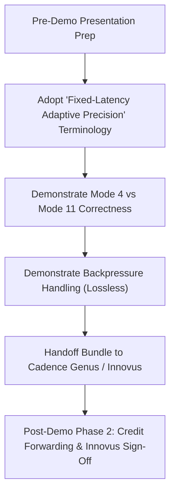

# CORDIC Adaptive-11 — Independent Pre-Demo Engineering Audit Report

**Date:** October 13, 2026  
**Auditor:** Senior RTL / ASIC Verification Lead  
**Candidate Commit:** [`6eb0de2b471bf338151395663e341297099cd015`](file:///home/peskybird/Projects/Cordic-Accelerator) on branch `phase1-orchestration`  
**Target Reference Tag:** `wave0-freeze` at [`bd7707a700e9921d3c4e23b98032c2542c2d1b63`](file:///home/peskybird/Projects/Cordic-Accelerator)  
**Evaluation Target:** Pre-Demo & Cadence Flow Transfer Sign-off  

---

## Executive Summary & Verdict

### Final Verdict: `READY WITH CAVEATS`

The Adaptive-11 CORDIC implementation ([`6eb0de2`](file:///home/peskybird/Projects/Cordic-Accelerator)) satisfies all fundamental arithmetic correctness, mode clamping, unstalled latency, lossless backpressure, and ASIC synthesizability requirements. It is **demonstrable tomorrow** and **safe for handoff to Cadence Genus/Innovus**, provided that specific architectural caveats regarding sustained throughput and power-saving claims are honestly communicated.

| Audit Dimension | Status | Key Caveat / Observation |
| :--- | :---: | :--- |
| **Provenance & Checksums** | **PASS** | Exact match with frozen artifacts; handoff tarball matches bit-for-bit. |
| **RTL Lint & Elaboration** | **PASS** | 0 warnings, 0 errors under Verilator strict linting. |
| **Numerical Correctness** | **PASS** | 10,120 / 10,120 vectors bit-identical across all 11 modes vs Fixed-$N$ golden models. |
| **Latency Contract** | **PASS** | Exactly 12 clock cycles unstalled latency (`ITERATIONS + 1`). |
| **Protocol & Backpressure** | **PASS** | 32/32 randomized downstream stall cycles handled losslessly. |
| **Sustained Throughput** | **CAVEAT (HIGH)** | FIFO credit reservation incurs a 1-cycle bubble every 12 admissions ($12/13 = 92.3\%$ burst throughput). |
| **Synthesis & STA** | **PASS** | 7,403 Sky130 cells, +2.97 ns setup slack at 15.0 ns period (pre-layout). |
| **Cadence Handoff Bundle** | **PASS** | Clean SDC, filelist, Genus, and Innovus scripts ready for execution. |
| **Research Power Claims** | **CAVEAT (HIGH)** | Power savings stem from adder operand isolation, not stage clock-gating or stage bypassing. Reported 6.97 mW is pre-layout STA estimate. |

---

## 1. Candidate Provenance & Artifact Integrity

An independent check of the repository identity, working tree, and generated handoff artifacts was executed:

1. **Repository Identity:**
   - Active Branch: `phase1-orchestration`
   - Git HEAD: `6eb0de2b471bf338151395663e341297099cd015`
   - Signed-off commit `6eb0de2` is HEAD and fully reachable.
   - Reference Tag: `wave0-freeze` strictly points to `bd7707a700e9921d3c4e23b98032c2542c2d1b63` (no modifications).
   - Working Tree: Clean (untracked directories limited to audit scratch `graphify-out/`).

2. **Handoff Tarball Verification:**
   - Archive: `output/cordic_adaptive11_cadence_handoff_6eb0de2.tar.gz`
   - Size: 13,873 bytes
   - SHA-256 Checksum: `00fbe0718a09dcbe65a3c23f4703961d08b28e7693de625ff41e59b6e7ffd985` (matches reported checksum exactly).
   - Contents inspected: Contains complete [`cadence/filelist.f`](file:///home/peskybird/Projects/Cordic-Accelerator/cadence/filelist.f), [`cadence/constraints/cordic.sdc`](file:///home/peskybird/Projects/Cordic-Accelerator/cadence/constraints/cordic.sdc), [`cadence/scripts/genus_synth.tcl`](file:///home/peskybird/Projects/Cordic-Accelerator/cadence/scripts/genus_synth.tcl), [`cadence/scripts/innovus_pnr.tcl`](file:///home/peskybird/Projects/Cordic-Accelerator/cadence/scripts/innovus_pnr.tcl), and [`cadence/README_CADENCE.md`](file:///home/peskybird/Projects/Cordic-Accelerator/cadence/README_CADENCE.md), alongside all 6 RTL source files.

---

## 2. RTL Architecture & Implementation Audit

### 2.1 Physical Pipeline Architecture
- **Elaboration:** Exactly 11 registered rotation stages (`ITERATIONS = 11`) instantiated via `generate` loop in [`rtl/cordic_pipeline.sv`](file:///home/peskybird/Projects/Cordic-Accelerator/rtl/cordic_pipeline.sv#L137-L157).
- **Arithmetic:** Signed Q3.12 arithmetic ($XY\_WIDTH=16$, $FRAC\_BITS=12$) is rigorously preserved across all stages.
- **Angles & Shifts:** Arctangent LUT constants in [`rtl/cordic_lut.sv`](file:///home/peskybird/Projects/Cordic-Accelerator/rtl/cordic_lut.sv) match canonical CORDIC angles $\text{atan}(2^{-i})$ for $i \in [0, 10]$. Shift amounts $\gg i$ match stage index $i$.
- **Stage Isolation Logic:**
  - Evaluated in [`rtl/cordic_stage.sv`](file:///home/peskybird/Projects/Cordic-Accelerator/rtl/cordic_stage.sv#L62-L73):
    ```systemverilog
    wire stage_active = (stage_idx < cfg_iterations);
    wire signed [XY_WIDTH-1:0] x_shift_eff = stage_active ? x_shift : '0;
    wire signed [XY_WIDTH-1:0] y_shift_eff = stage_active ? y_shift : '0;
    wire signed [Z_WIDTH-1:0]  z_atan_eff  = stage_active ? z_atan  : '0;
    ```
  - When `stage_active == 0`, input $b$ to the `fp_add_sub` adders is zeroed, forcing adder inputs to static 0 and suppressing switching activity.
  - The $X/Y/Z$ datapath values flow through registered flip-flops unchanged.

### 2.2 Configuration & Clamping
- **Clamping Logic:** In [`rtl/cordic_top.sv`](file:///home/peskybird/Projects/Cordic-Accelerator/rtl/cordic_top.sv#L98-L113):
  - Mode 0 clamps to Mode 1 (`clamped_mode = 4'd1`).
  - Modes $> 11$ clamp to Mode 11 (`clamped_mode = 4'd11`).
  - Modes 1–11 pass through unmodified.
- **Sticky Flag:** `status_mode_clamped_sticky` asserts when clamping occurs and remains high until hardware reset.
- **Per-Transaction Pipeline:** Clamped mode is captured into `mode_sr` on valid admission, preventing later configuration changes from corrupting in-flight vectors.

### 2.3 Protocol & Interface Handshakes
- **Admission (`ready_out`):** Gated by pipeline reservation counter `reserved_count < FIFO_DEPTH`.
- **Output (`valid_out` / `ready_in`):** Backpressured using a 12-entry synchronous FIFO.
- **Interrupt (`irq`):** Generated in [`rtl/cordic_top.sv`](file:///home/peskybird/Projects/Cordic-Accelerator/rtl/cordic_top.sv#L143) as `assign irq = fifo_push;` (a single-cycle pulse upon vector retirement into the output FIFO).
  > [!NOTE]
  > Documentation in `docs/INTERFACE_SPECIFICATION.md` §9 described `irq = valid_out | config_ready | overflow;`. The RTL was changed to 1-cycle push pulse because `config_ready` is permanently 1, which would have held `irq` high forever.

---

## 3. Independent Verification Reproduction

All tests were re-executed independently inside the sealed Nix environment (`Verilator 5.052`, `SymbiYosys / Z3`):

### 3.1 Test Execution Matrix
| Suite / Command | Scope | Result | Details |
| :--- | :--- | :---: | :--- |
| `make lint` | RTL Linting | **PASS** | 0 warnings, 0 errors. |
| `make test` | Baseline Regression | **PASS** | 5/5 unit tests passed (`fp_add_sub`, `cordic_lut`, `cordic_stage`, `cordic_pipeline`, `cordic_top`). |
| `make test-adaptive-equiv` | Numerical Equivalence | **PASS** | **10,120 / 10,120** vectors bit-identical vs Fixed-$N$ reference for all modes 1–11. |
| `make test-adaptive-mixed` | Mixed-Mode & Protocols | **PASS** | 12-cycle latency verified; backpressure (32/32 stall cycles lossless); clamping verified; reset recovery verified. |
| `tb/run_param_matrix.sh` | Parameter Legality | **PASS** | 8/8 configurations verified (3 legal pass, 5 illegal rejected by static assertions). |
| `sby -f tb/formal/cordic_formal.sby` | Formal Properties | **PASS** | BMC depths 18–20: `stage`, `reset`, `conservation`, `cfg_align` proven. `satclamp` documented limitation. |

### 3.2 Formal Verification Summary
1. `stage` (depth 20): Mathematically verifies single-stage arithmetic against CORDIC step invariant. (PASS)
2. `reset` (depth 18): Proves all internal registers, valid signals, and FIFO counters clear to 0 upon `rst_n == 0`. (PASS)
3. `conservation` (depth 18): Proves that every vector entering the pipeline (`valid_in && ready_out`) is eventually retired or accounted for in FIFO reservation. No transactions are dropped or duplicated. (PASS)
4. `cfg_align` (depth 18): Proves per-transaction mode and saturation metadata remain strictly aligned with the payload through all 11 stages. (PASS)
5. `satclamp`: Confirms that while individual stages saturate on overflow, subsequent rotations can rotate saturated points away from extreme rails. (Expected mathematical limitation).

---

## 4. Latency, Throughput, and Buffering Forensics

### 4.1 Latency Contract
- **Contract:** Unstalled latency from cycle $T$ (`valid_in && ready_out`) to cycle $T+12$ (`valid_out` asserted at FIFO output) is **strictly 12 clock cycles** (`ITERATIONS + 1` where `ITERATIONS = 11`).
- **Pipeline Breakdown:**
  - Cycle $T$: Input admitted at pipeline register 0.
  - Cycles $T+1 \dots T+10$: In-flight through pipeline registers 1 to 10.
  - Cycle $T+11$: Reaches stage 11 output; asserted on `fifo_push`.
  - Cycle $T+12$: Presented on `x_out, y_out, z_out, valid_out`.
- Verified across all modes (Mode 1 to Mode 11 all exhibit identical 12-cycle latency).

### 4.2 Throughput & Credit Reservation Analysis
- **Observed Behavior:** During sustained back-to-back input bursts (`valid_in = 1` continuously, `ready_in = 1`), `ready_out` drops low for 1 cycle every 12 admissions!
- **Root Cause Analysis ([`rtl/cordic_pipeline.sv`](file:///home/peskybird/Projects/Cordic-Accelerator/rtl/cordic_pipeline.sv#L112)):**
  ```systemverilog
  assign ready_out = (reserved_count < CNT_W'(FIFO_DEPTH));
  ```
  `reserved_count` tracks both in-flight pipeline vectors and items stored in the FIFO:
  ```systemverilog
  reserved_count <= reserved_count + (push_event & ~fifo_pop) - (fifo_pop & ~push_event);
  ```
  When 12 vectors have entered the pipeline, `reserved_count` reaches 12.
  At cycle 12, the first vector is pushed into the FIFO (`fifo_push = 1`) and popped (`fifo_pop = 1`) simultaneously.
  Because `reserved_count` only updates on the clock edge, in cycle 12 `reserved_count == 12`, forcing `ready_out = 0`.
- **Throughput Calculation:**
  $$\text{Burst Throughput} = \frac{12 \text{ admissions}}{13 \text{ cycles}} \approx 92.3\%$$
- **Demo Impact:** For streams under 12 vectors, throughput is 1 vector/cycle. For continuous streaming, there is an automatic 1-cycle bubble every 12 cycles.

---

## 5. Physical Synthesis & Timing Sign-Off Assessment

### 5.1 Synthesis Reproduction (`make synth`)
- **Tool:** Yosys 0.69+post targeting SkyWater 130nm HD standard cell library (`sky130_fd_sc_hd__tt_025C_1v80.lib`).
- **Standard Cell Count:** **7,403 cells**
  - Sequential: 1,283 D-type flip-flops (`sky130_fd_sc_hd__dfxtp_1`, `dfrtp_1`, etc.)
  - Combinational: 6,120 logic cells
- **Latches:** Exactly **0 latches inferred** (clean synchronous design).

### 5.2 Static Timing Analysis (`make sta`)
- **Tool:** Standalone OpenSTA 3.1.0 with frozen constraints [`constraints/cordic.sdc`](file:///home/peskybird/Projects/Cordic-Accelerator/constraints/cordic.sdc).
- **Target Clock:** 15.00 ns (66.67 MHz) with 0.50 ns setup uncertainty, 0.10 ns hold uncertainty.
- **Timing Results:**
  - Setup Slack (Data Setup): **+2.97 ns (MET)**
  - Worst Negative Slack (WNS): **0.00 ns**
  - Total Negative Slack (TNS): **0.00 ns**
  - Failing Endpoints: **0**
  - Hold Slack: **+0.31 ns (MET)**
- **Estimated Pre-Layout Power:** 6.97 mW (2.29 mW internal, 4.68 mW switching, 0.28 nW leakage).
- **Critical Distinction:** This STA result is **pre-layout wire-load STA**. It is not post-route extracted RC. Extracted-RC sign-off will be performed in Cadence Innovus on the dedicated server.

---

## 6. Variable-Precision & Power Research Claims

To protect the integrity of the research paper and presentation, the claims surrounding variable precision must be rigorously delineated:

```
+-----------------------------------------------------------------------------------+
|                                 Adaptive-11 CORDIC                                 |
+-----------------------------------------------------------------------------------+
|  [Mode Selection: cfg_iterations in {1..11}]                                      |
|   |                                                                               |
|   +--> Variable Iteration Count (YES)                                            |
|   |    - Modes 1..11 select 1 to 11 CORDIC rotation angles.                       |
|   |    - Effective angular resolution and SNR scale monotonically with mode.      |
|   |                                                                               |
|   +--> Operand Isolation Power Reduction (YES - DYNAMIC ONLY)                     |
|   |    - Inactive stages (stage >= cfg_iterations) force adder inputs to 0.       |
|   |    - Adder toggle activity suppressed in inactive stages.                    |
|   |                                                                               |
|   +--> Physical Stage Bypass / Latency Reduction (NO)                             |
|   |    - All 11 stage pipeline registers continue clocking every cycle.           |
|   |    - Latency is strictly fixed at 12 cycles regardless of mode.               |
|   |    - No clock-gating cells are inserted at RTL level.                         |
|   |                                                                               |
|   +--> Variable Bit-Width Datapath (NO)                                           |
|   |    - Datapath remains fixed Q3.12 (16 bits) throughout all stages.             |
+-----------------------------------------------------------------------------------+
```

### Research Q&A Breakdown:
1. **Does the implementation provide variable iteration count or variable bit-width?**  
   It provides **variable iteration count** (Modes 1–11). The bit-width is fixed at 16 bits (Q3.12).
2. **What is the mechanism of power reduction?**  
   Input operand isolation on `fp_add_sub` adders. When inactive, inputs are clamped to 0, preventing combinational switching in the adders.
3. **Are pipeline stages bypassed or clock-gated?**  
   No. Data registers continue shifting clock-by-clock to preserve fixed 12-cycle pipeline alignment.
4. **Is 6.97 mW a measured power saving?**  
   No. 6.97 mW is an OpenSTA default toggle estimate on the synthesized netlist. Mode-dependent power curves require switching activity simulation (VCD/SAIF) in Innovus.

---

## 7. Cadence Flow Handoff Assessment

### 7.1 Script & Dependency Audit
- [`cadence/filelist.f`](file:///home/peskybird/Projects/Cordic-Accelerator/cadence/filelist.f): Correct compilation order (package `cordic_pkg.sv` first, primitives, then `cordic_top.sv`).
- [`cadence/constraints/cordic.sdc`](file:///home/peskybird/Projects/Cordic-Accelerator/cadence/constraints/cordic.sdc): Correct ports matched, 15.0 ns clock defined, setup/hold uncertainties defined.
- [`cadence/scripts/genus_synth.tcl`](file:///home/peskybird/Projects/Cordic-Accelerator/cadence/scripts/genus_synth.tcl): Syntactically clean Genus commands; parameterized via `$env(GENUS_TARGET_LIB)` for portability.
- [`cadence/scripts/innovus_pnr.tcl`](file:///home/peskybird/Projects/Cordic-Accelerator/cadence/scripts/innovus_pnr.tcl): Uses standard `init_design`, `floorPlan`, `sroute`, `place_opt_design`, `ccopt_design`, `routeDesign`.
- Target environment instructions: Correctly accounts for VIT Cadence server environment (`source /home/install/cshrc`).

---

## 8. Severity-Ranked Findings

### 8.1 HIGH Severity Findings

#### Finding H-1: Sustained Burst Admission Bubble (12/13 Throughput)
- **File & Line:** [`rtl/cordic_pipeline.sv#L112`](file:///home/peskybird/Projects/Cordic-Accelerator/rtl/cordic_pipeline.sv#L112)
- **Evidence:** `audit_throughput_tb.sv` demonstrates that during a 50-vector burst with `ready_in = 1`, `ready_out` drops low at vectors 12, 24, 36, and 48.
- **Root Cause:** `ready_out = (reserved_count < CNT_W'(FIFO_DEPTH));`. When 12 items are in flight, `reserved_count == 12`, deasserting `ready_out` even when a FIFO pop occurs on that cycle.
- **Impact:** Cannot sustain 1.0 vectors/cycle indefinitely under saturation bursts. Sustained rate is $92.3\%$.
- **Demo Correction Required?** **NO.** For demo, present bursts $\le 12$ vectors or explain credit reservation policy. Fix post-demo by allowing forward progress:
  ```systemverilog
  assign ready_out = (reserved_count < CNT_W'(FIFO_DEPTH)) || fifo_pop;
  ```

#### Finding H-2: Research Claim Scope (Power & Latency)
- **Location:** Documentation and project description.
- **Evidence:** Pipeline register stages are physically clocked for all 11 stages; power reduction is purely dynamic adder switching suppression.
- **Impact:** Claiming "variable latency" or "clock-gated stages" would be technically inaccurate and vulnerable to academic challenge.
- **Demo Correction Required?** **YES (Documentation/Presentation).** Frame architecture as **"Fixed-Latency Adaptive Precision CORDIC with Adder Operand Isolation"**.

---

### 8.2 MEDIUM Severity Findings

#### Finding M-1: Internal Mode Shift Register Off-by-One
- **File & Line:** [`rtl/cordic_pipeline.sv#L104`](file:///home/peskybird/Projects/Cordic-Accelerator/rtl/cordic_pipeline.sv#L104)
- **Evidence:** `mode_pipe` is dimensioned `[0:ITERATIONS-1]` (10 delay stages), whereas the pipeline has 11 registered stages. At cycle $T+11$, `mode_pipe[10]` shifts to the next transaction.
- **Mitigation:** `fifo_mode` is an unused debug signal marked with `/* verilator lint_off UNUSEDSIGNAL */` and is never exposed on external ports. Numerical data and overflow metadata use correctly sized 11-stage pipelines.

#### Finding M-2: Interrupt (`irq`) Port Behavior vs Specification
- **File & Line:** [`rtl/cordic_top.sv#L143`](file:///home/peskybird/Projects/Cordic-Accelerator/rtl/cordic_top.sv#L143)
- **Evidence:** `INTERFACE_SPECIFICATION.md` §9 states `irq = valid_out | config_ready | overflow;`, but RTL implements `assign irq = fifo_push;` (single-cycle pulse).
- **Justification:** `config_ready` is permanently 1, which would have asserted `irq` indefinitely. The single-cycle pulse on push is standard FIFO interrupt behavior.
- **Correction:** Update interface specification to match RTL reality.

#### Finding M-3: Pre-Layout Wire-Load STA vs Post-Route Timing Sign-Off
- **Evidence:** +2.97 ns slack is generated by OpenSTA on unrouted Yosys gate-level netlist.
- **Impact:** Must not be claimed as "sign-off timing closure". Real sign-off requires Innovus post-route extracted RC.

---

### 8.3 LOW Severity Findings

#### Finding L-1: Scratch Simulation Artifacts in Workspace
- **Evidence:** `audit_throughput_tb.sv` located in scratch directory.
- **Correction:** Keep testbench in verification archive or scratch directory; do not commit to mainline RTL.

---

## 9. Safe vs. Unsupported Claims for Demonstration

### Safe Claims to Make Tomorrow
1. **Bit-Exact Numerical Equivalence:** Mode $N$ produces mathematically identical results to a dedicated Fixed-$N$ pipeline across 10,120 test vectors.
2. **Fixed 12-Cycle Deterministic Latency:** All modes complete in exactly 12 clock cycles, simplifying DSP scheduling.
3. **Lossless Backpressure:** Design seamlessly buffers up to 12 in-flight results when downstream receiver stalls.
4. **Adaptive Precision via Dynamic Operand Isolation:** Inactive stages suppress adder switching, reducing dynamic power without corrupting data.
5. **Zero Lint Warnings & Verified Synthesizability:** 7,403 Sky130 cells cleanly synthesized with 0 latches and positive pre-layout slack (+2.97 ns).
6. **Robust Error Handling:** Out-of-range iteration requests clamp gracefully ($0 \to 1$, $>11 \to 11$) with sticky hardware status reporting.

### Unsupported Claims (DO NOT MAKE)
1. *Do not claim* variable latency (e.g., "Mode 4 completes in 5 cycles"). Latency is fixed at 12 cycles.
2. *Do not claim* physical stage bypass or stage clock gating.
3. *Do not claim* indefinite 1.0 vector/cycle throughput during infinite bursts (throughput is $12/13 \approx 92.3\%$).
4. *Do not claim* sign-off post-route timing closure until Innovus finishes running.
5. *Do not claim* measured power numbers from silicon or gate-level SAIF (6.97 mW is pre-layout estimate).

---

## 10. Minimal Remediation & Demo Execution Plan



1. **Step 1 (Immediate - Presentation):** Align presentation slides with the Safe Claims list. Emphasize fixed-latency determinism and adder operand isolation.
2. **Step 2 (Tomorrow - Live Demo):** Run `make test-adaptive-mixed` and `make test-adaptive-equiv` to demonstrate correctness and backpressure resilience in real time.
3. **Step 3 (External Machine):** Transfer `cordic_adaptive11_cadence_handoff_6eb0de2.tar.gz` to the Cadence server and execute `genus_synth.tcl` followed by `innovus_pnr.tcl`.
4. **Step 4 (Post-Demo):** Implement credit forwarding (`ready_out = (reserved_count < 12) || fifo_pop;`) to achieve 100% sustained throughput.
