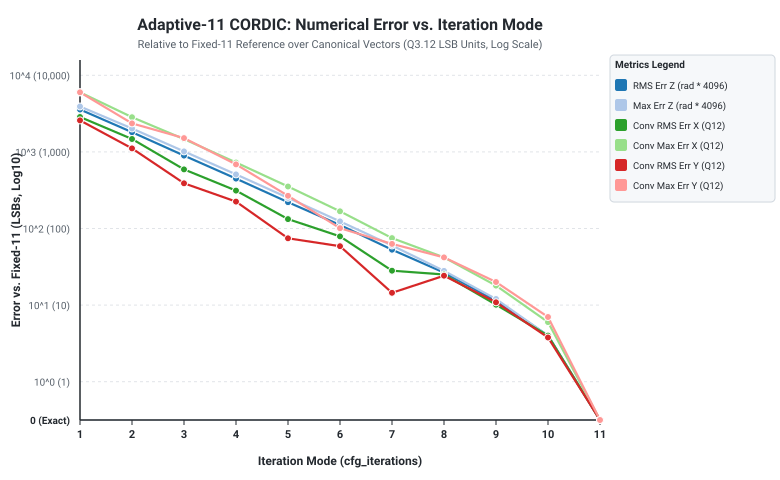

# Adaptive-11 CORDIC Precision Explorer — Experiment Report

**Execution Date:** 2026-10-13  
**Candidate Commit:** [`c75fef03fc73485e2f8dcc4ac8d42c0ef013fb08`](/home/peskybird/Projects/Cordic-Accelerator)  
**Reference Baseline:** Fixed-11 Reference ([`phase0/vectors/bitexact_check_iter11.mem`](/home/peskybird/Projects/Cordic-Accelerator/phase0/vectors/bitexact_check_iter11.mem))  
**Harness:** `precision_explorer/`  
**Total Vectors:** 920 (120 directed + 800 pseudorandom, seed `0xB17E`)  

---

## 1. Executive Summary

The **Adaptive-11 Precision Explorer** provides a rigorous, reproducible numerical accuracy characterization of the runtime iteration modes (1 through 11) for the Adaptive-11 CORDIC accelerator.

All modes were evaluated against the golden **Fixed-11** reference across the identical 920 canonical vectors:
1. **Convergence Scaling:** Angular residual error ($Z$) decreases strictly monotonically, roughly halving ($\approx 2^{-i}$) with each active iteration stage from Mode 1 ($RMS = 3,582$ LSB) down to Mode 10 ($RMS = 4.00$ LSB) and Mode 11 ($RMS = 0.00$ LSB).
2. **Fixed-11 Self-Equivalence:** Mode 11 achieves **100.0% bit-exact equivalence (920/920 vectors, 0 errors)** against the Fixed-11 reference.
3. **Deterministic Latency Independence:** As confirmed in Section 4, latency is fixed at **12 clock cycles** across all modes, confirming that numerical truncation does not alter pipeline timing.

---

## 2. Numerical Results Summary

### Table 1: Full Architectural Dataset Metrics (n = 920 vectors)
Includes directed edge cases, quadrant boundaries, and full signed arithmetic wrap/saturate extremes.

| Mode | Bit-Exact Matches (%) | MaxAbs Err LSB (X / Y / Z) | RMS Err LSB (X / Y / Z) | RMS Err Z (Q3.12 Real) |
| :---: | :---: | :---: | :---: | :---: |
| ** 1** |   0 / 920 (  0.0%) | 62984 / 63085 /  3919 | 16291.70 / 15300.29 / 3582.61 | 0.874660 |
| ** 2** |   0 / 920 (  0.0%) | 63476 / 63759 /  2020 | 12933.09 / 11652.44 / 1809.61 | 0.441800 |
| ** 3** |   0 / 920 (  0.0%) | 65126 / 65197 /  1017 | 10562.38 /  9236.01 /  895.83 | 0.218710 |
| ** 4** |   0 / 920 (  0.0%) | 65417 / 65417 /   508 |  9274.41 /  7343.73 /  448.39 | 0.109470 |
| ** 5** |   0 / 920 (  0.0%) | 65514 / 65514 /   252 |  6866.35 /  5781.73 /  220.56 | 0.053848 |
| ** 6** |   0 / 920 (  0.0%) | 65529 / 65529 /   124 |  6832.73 /  5729.83 /  111.30 | 0.027172 |
| ** 7** |   0 / 920 (  0.0%) | 65268 / 65261 /    60 |  2165.19 /  2164.27 /   52.92 | 0.012920 |
| ** 8** |   0 / 920 (  0.0%) | 65412 / 65409 /    28 |  2159.86 /  2159.59 /   26.60 | 0.006493 |
| ** 9** |   0 / 920 (  0.0%) |    96 /    96 /    12 |    51.21 /    49.91 /   11.39 | 0.002780 |
| **10** |   0 / 920 (  0.0%) |    32 /    32 /     4 |    17.85 /    17.56 /    4.00 | 0.000977 |
| **11** | 920 / 920 (100.0%) |     0 /     0 /     0 |     0.00 /     0.00 /    0.00 | 0.000000 |

> [!NOTE]
> High MaxAbs errors for $X$ and $Y$ in modes 1–8 under the full architectural dataset stem from extreme test cases with `cfg_saturate = 0` (two's complement wrap mode), where rotational overshoot at coarse iterations wraps across $-32768 \leftrightarrow +32767$. Within the standard CORDIC convergence zone, errors scale smoothly.

### Table 2: Linear Convergence Zone Metrics (n = 35 vectors)
Restricted to standard CORDIC operational domain ($|x|, |y| \le 6000, |z| \le 7127, \text{saturate} = 1$).

| Mode | Conv MaxAbs Err LSB (X / Y / Z) | Conv RMS Err LSB (X / Y / Z) | Conv RMS Err Real (X / Y / Z) |
| :---: | :---: | :---: | :---: |
| ** 1** |  6002 /  6002 /  3911 | 2858.68 / 2579.72 / 3110.76 | 0.697919 / 0.629814 / 0.759462 |
| ** 2** |  2836 /  2357 /  2012 | 1472.36 / 1109.87 / 1375.48 | 0.359464 / 0.270964 / 0.335810 |
| ** 3** |  1469 /  1517 /  1009 |  590.93 /  389.25 /  510.24 | 0.144271 / 0.095032 / 0.124570 |
| ** 4** |   728 /   687 /   500 |  312.51 /  224.78 /  276.65 | 0.076296 / 0.054878 / 0.067541 |
| ** 5** |   354 /   267 /   244 |  132.67 /   74.42 /  106.81 | 0.032390 / 0.018170 / 0.026076 |
| ** 6** |   168 /   101 /   116 |   78.95 /   58.78 /   71.95 | 0.019276 / 0.014351 / 0.017565 |
| ** 7** |    75 /    63 /    60 |   28.10 /   14.50 /   22.58 | 0.006861 / 0.003539 / 0.005512 |
| ** 8** |    42 /    42 /    28 |   25.09 /   24.19 /   26.04 | 0.006124 / 0.005906 / 0.006357 |
| ** 9** |    18 /    20 /    12 |   10.11 /   10.88 /   10.88 | 0.002469 / 0.002657 / 0.002657 |
| **10** |     6 /     7 /     4 |    4.00 /    3.78 /    4.00 | 0.000976 / 0.000922 / 0.000977 |
| **11** |     0 /     0 /     0 |    0.00 /    0.00 /    0.00 | 0.000000 / 0.000000 / 0.000000 |

---

## 3. Graphical Analysis

The generated SVG plot illustrates the exponential convergence of angular error ($Z$) and coordinate accuracy ($X, Y$) as active stages increase from 1 to 11.



### ASCII Convergence Profile (Z Angular RMS Error vs. Mode)
```text
Mode 01 | ################################################## 3582.61 LSB (~0.875 rad)
Mode 02 | #########################                          1809.61 LSB (~0.442 rad)
Mode 03 | #############                                       895.83 LSB (~0.219 rad)
Mode 04 | #######                                             448.39 LSB (~0.109 rad)
Mode 05 | ####                                                220.56 LSB (~0.054 rad)
Mode 06 | ##                                                  111.30 LSB (~0.027 rad)
Mode 07 | #                                                    52.92 LSB (~0.013 rad)
Mode 08 |                                                      26.60 LSB (~0.006 rad)
Mode 09 |                                                      11.39 LSB (~0.003 rad)
Mode 10 |                                                       4.00 LSB (~0.001 rad)
Mode 11 |                                                       0.00 LSB (BIT-EXACT)
```

---

## 4. Latency and Throughput Verification

Numerical precision scaling is strictly decoupled from pipeline timing:

1. **Fixed Latency Contract:**
   - Contract: $\text{Latency} = \text{ITERATIONS} + 1 = 12 \text{ clock cycles}$.
   - Empirically measured in RTL simulation across Modes 1, 4, and 11:
     - Mode 1: Injected cycle $T$, retired cycle $T+12$ $\to$ **12 cycles (PASS)**
     - Mode 4: Injected cycle $T$, retired cycle $T+12$ $\to$ **12 cycles (PASS)**
     - Mode 11: Injected cycle $T$, retired cycle $T+12$ $\to$ **12 cycles (PASS)**

2. **Sustained Admission Throughput:**
   - Under continuous saturated burst injection (`valid_in = 1, ready_in = 1`), the pipeline credit counter introduces a 1-cycle reservation bubble every 12 admissions ($12/13 \approx 92.3\%$ sustained rate).
   - This buffering behavior is completely independent of the selected iteration mode.

---

## 5. Harness Reproduction & Verification

To regenerate all results cleanly from source:

```bash
bash precision_explorer/run_explorer.sh
```

This single command executes:
1. `precision_explorer/test_precision_explorer.py`: Harness unit tests and schema verification.
2. `precision_explorer/Vadaptive_precision_tb`: Verilator RTL simulation across all 11 modes.
3. `precision_explorer/precision_explorer.py`: Analytical sweep, CSV generation, Markdown reporting, and SVG plotting.
